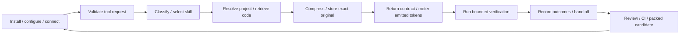

# Knitbrain end-to-end audit and repair map

Audit date: **22 October 2026**. Source base: `957e5b1e88cf74856cb85e8ef61a4b6244308eee`, plus the explicitly identified October 21 local scanning/routing changes. This is the first-stage repair plan, not a claim that the MCP is corrected or fully optimized.

## Decision

**Correct completion and output contracts first; trustworthy accounting second; measured optimization third.** The existing green suite is necessary but insufficient: new probes reproduce ten functional defects, one recall-retention limitation and a broken library example. More aggressive compression must wait until the system can report those results honestly.

The live managed MCP is a separate artifact: it still failed home-root search with `EPERM` and chose an unrelated payments skill during this audit. A locally rebuilt module does not change an already running host connection.

## Evidence and backlog

- [Full findings, fixes and acceptance criteria](FINDINGS.md): 32 items, proposed owner areas, evidence confidence and dependencies.
- [Machine-readable backlog](findings.json): authoritative IDs and status, suitable for subsequent PRs/issues.
- [All 37 registered tools](tools.json): every tool assigned an area, findings and a contract test obligation. Inventory is not proof that every behavior has been tested.
- [Executable diagnostic observations](probes.json), reproduced by `node scripts/audit-probes.mjs`; exit zero means the diagnostic ran, **not** that the defects passed acceptance.
- [Verification record](verification.json) and [clean-build output](verify-output.txt): command exit codes and exact scope.
- [GitHub/npm snapshot](repository.json): main, CI, branch policy, local/npm version split.
- [Existing upstream dependency advisories](runtime-dependencies.json): 8 affected runtime packages, including 1 critical and 3 high package-level entries. Applicability to this local stdio server is not established by an advisory listing alone. Novel vulnerability details must remain private under [SECURITY.md](../../../SECURITY.md).
- [October 21 local fixes](../../local-audit-2026-10-21.md): provenance for inherited changes, separately reverified on this date.
- [Official MCP tool specification](https://modelcontextprotocol.io/specification/2025-06-18/server/tools): reference for input validation, error signaling and structured-result contracts. SDK upgrade work must check its chosen protocol version separately.

## End-to-end flow and repair boundaries



| Boundary | Principal work | Findings |
|---|---|---|
| Installation and root identity | One root, non-clobbering setup, correct executable and reconnect provenance | KB-013, KB-019, KB-027, KB-032 |
| Request and response contracts | Runtime schemas, correct errors, JSON survives all advisories | KB-002, KB-003, KB-023 |
| Routing and planning | Mutation intent, domain matching, explicit abstention | KB-009, KB-010 |
| Search and claim facts | Resilient bounded scans, fresh graph, exact symbol/file verification | KB-004, KB-005, KB-011, KB-025 |
| Compression and recall | Full-response never-expand, available original, retention policy | KB-008, KB-012, KB-024 |
| Context and savings | Session versus lifetime, known limits, actual emitted/recall costs | KB-006, KB-007, KB-030 |
| Execution and workers | Meaningful gate, deadlines, no shared-worktree fallback, useful failures | KB-001, KB-015, KB-016, KB-017 |
| Durable memory and privacy | Concurrent writes, state integrity, retention and network boundaries | KB-014, KB-028 |
| Real host behavior | Connected-host capability evidence and bounded governance claims | KB-026, KB-029 |
| GitHub and delivery | Dependency triage, main policy, reproducible CI, reviewable backlog | KB-018, KB-020, KB-021, KB-022, KB-031 |

## Repair sequence and gates

Priorities are proposed release priorities, not claims of exploited vulnerabilities. **P0** means block stronger completion/correctness claims until fixed; **P1** core reliability/measurement or release risk; **P2** follow-on quality/performance. Dependencies in the backlog determine technical order even within a slice.

| Slice | Work | Start/finish gate | Proposed responsibility |
|---|---|---|---|
| 0 — Preserve and baseline | Deliver map; review inherited scan/skill patches; record source, npm and host separately | Current suite and tool E2E recorded; reproducible diagnostic evidence; map validator passes | Maintainer + test |
| 1 — Correctness foundations | KB-003, KB-001, KB-002, KB-013, KB-011, KB-004, KB-005, KB-009, KB-010; dependency triage KB-020 runs alongside | Each defect red-before/green-after; strict default and real stdio tests; no false green/false fact/malformed JSON | MCP + index + workflow |
| 2 — Honest optimization | KB-008, KB-006, KB-007, KB-012, then KB-014 and KB-025 measurements | Final emitted output never expands; resets do not inherit session savings; recall/retry cost included; stale caches cannot buy performance | Optimizer + storage + meter |
| 3 — Bounded operation | KB-015, KB-016, KB-017, KB-027, KB-026, KB-029, KB-028 | Timeout/isolation failure injection; two-project isolation; real-host lifecycle evidence or explicit unverified labels | Runner + platforms + security |
| 4 — Prove benefit | KB-024, KB-030, KB-023 | Held-out task correctness and net token/latency/cost results versus no optimization and retrieval-only baselines | Evals + test |
| 5 — Review and release candidate | KB-018, KB-022, KB-032, KB-021, KB-019 | Packed consumer works; required CI and reviews; support policy tested; explicit approval before any version bump/publish | CI + release + repository admin |

No invented implementation hours or delivery dates: each slice needs measured baseline/review time before scheduling. Owner areas above are proposed, not named assignments. GitHub protection requires repository-admin action; no settings were silently changed.

## Optimization measurement contract

Use the **same versioned tasks and inputs** for four variants: unoptimized, retrieval only, compression only, combined. Run cold and warm conditions separately. Fixtures must cover code, JSON, logs, diffs, short/long prose, mixed/line-numbered output and high-value content in the elided middle; include small boundary payloads, noisy failures and long paths.

Record input/raw-output tokens, final emitted tokens including wrappers, standing schemas/instructions, exact recalls, repeated reads/retries, total task input/output tokens, completion/correctness score, latency p50/p95, memory and event-loop delay. Publish corpus size, tokenizer, runtime, host version and hardware. Provider cost needs actual provider usage/cache evidence; a token heuristic cannot prove billed savings.

For the reproduced boundary fixture: **86 input tokens → 73 skeleton tokens → 108 emitted tokens**, despite reporting 13 tokens saved. That is a repair target, not an optimization win. The existing synthetic real-shape weighted benchmark is **68.0%**; it does not establish a session-wide saving or universal answer preservation.

Release acceptance requires no regression on agreed task/decision checks, exact recovery while retention promises apply, valid machine contracts, and positive **net** benefit after recalls and overhead. Set latency/token targets from these measurements rather than promising a universal percentage.

## GitHub state and what this change prepares

The repository is public, main has no branch protection, and the ruleset list is empty at the snapshot. Latest returned main CI succeeded on July 8 at the audited base commit. npm latest is `0.20.0`; main declares `0.20.1`. These facts are time-sensitive; see the snapshot rather than assuming future state.

This change adds contribution guidance, issue forms, a PR checklist, a linked repair map and a consistency gate. It preserves the two inherited local fixes and their tests. It does not publish npm, bump a version, change GitHub admin policy, or claim the remaining backlog is implemented. Avoid mass-creating speculative issues; subsequent focused PRs should cite these IDs and their acceptance checks.

The library example was corrected and its documented method plus exact recovery were checked locally; a packed-consumer acceptance check is still tracked. CI now declares a read-only token, cancellation of superseded runs, job timeouts, the map gate and tool E2E. Action revision pinning, runtime policy and main protection remain open.

## Reproduce

```bash
npm ci
npm run verify
npm run e2e:tools
node scripts/audit-probes.mjs /tmp/knitbrain-audit-observations.json
node scripts/verify-audit-map.mjs
npm audit --omit=dev --json
```

HTTP tests require localhost access. Preserve a previous `dist` outside the checkout, or remove only generated `dist`, before a clean verification build; stale build output must not supply test results. Do not run live-provider tests, configure a host, restart a managed MCP, publish or release as an accidental side effect of these diagnostics.

## Closure rule

A finding closes only when its test demonstrates the failure before the patch, passes after it, required gates pass on the candidate artifact, and the scope of deployment is recorded. A probe run, added document, drafted issue, successful command unrelated to the finding, or old CI badge cannot close it. Unknown coverage remains explicitly unknown; this finite audit is not an assertion that all possible defects have been found.
