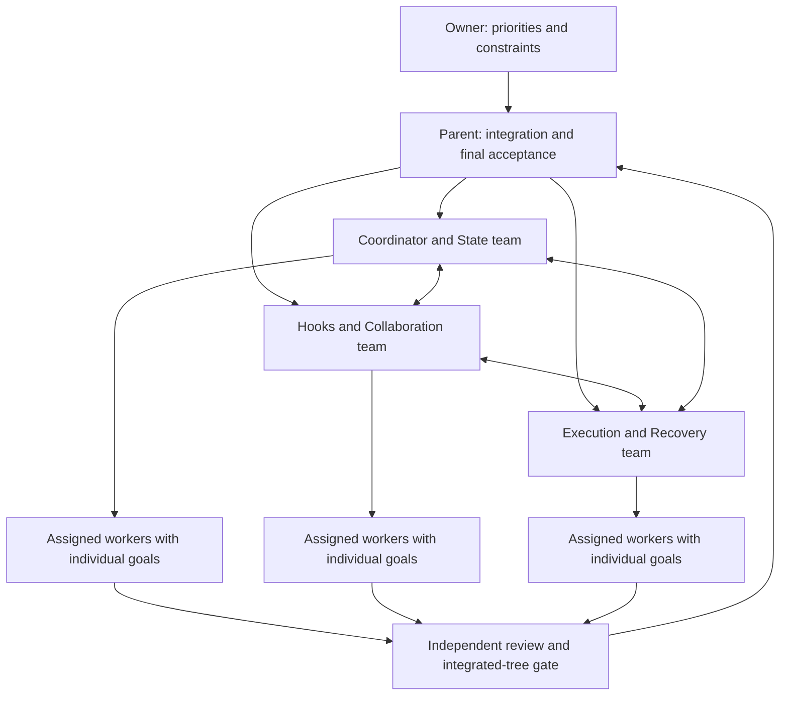

# Knitbrain office operating plan

Initialized 2026-10-23. This document defines the working team before further runtime implementation. [office.json](office.json) is the roster and assignment contract; [backlog.json](backlog.json) assigns all 32 audit findings without changing their existing acceptance status.

## Current state

- Parent coordinator: `/root`. Three domain leads have been initialized using the host's real subagent API and have exchanged planning messages directly.
- Phase: initialization complete when `node scripts/verify-office.mjs` passes and all three charters and peer agreements are recorded.
- Runtime implementation: source integration is undergoing verification; see [run controls](RUNNING.md). No background office daemon or indefinite worker loop has been launched. These session agents are not persistent OS services.
- Current host capacity: three active subagents plus the parent. Each domain starts with one lead/worker. N workers per domain is configurable in the office plan; excess workers must queue in fair batches. Additional names or configuration entries do not prove that agents were spawned.
- No merges, releases, installed MCP restarts, host configuration changes, or new paid external worker launches are part of initialization.

## Organization

| Team | Live agent identity | Owns now | Required handoff |
|---|---|---|---|
| Coordinator & State | `/root/orchestration_core` | Plan validation, run identity, durable state, locks, recovery, task dependencies | State API, task status and gate evidence contract |
| Hooks & Collaboration | `/root/hooks_lifecycle` | Worker context, supported hook events, domain messaging, observational telemetry | Context/message schemas and unsupported-hook fallback |
| Execution & Recovery | `/root/host_adapters` | External process launch/wait/cancel, timeout, output bounds, termination evidence | Process result and workspace quarantine contract |
| Integration & Review | `/root` | Scheduling, CLI, isolation policy, integration, audit ownership, final verification | Integrated changes and actual command outcomes |

Domain leads are accountable for work breakdown and cross-team dependencies. A lead may also act as its team's worker when N=1. Additional workers receive separate task IDs, scoped files, goals, inputs, acceptance commands and a reviewer; they never receive an undifferentiated copy of the entire parent task.

Existing audit work stays on the office backlog. Ownership indicates responsibility to schedule or review a finding, not that its fix is underway or complete. Optimization work requires a declared corpus and emitted-token/task-fidelity measurements after correctness gates pass. The existing synthetic benchmark is not evidence of production savings.

## Assignment and execution contract

Every assignment includes `runId`, `taskId`, `domainId`, `attempt`, goal, owner, file scope, dependencies, verify command, optional independent review command, workspace, retry policy, per-command timeout and escalation destination. A host-supplied `workerId` is optional; never invent one. Existing draft `domain` fields will be normalized once at ingress to `domainId` during integration.

1. Parent records the goal and acceptance gate, selects domain leads, and decomposes work with explicit dependencies.
2. Leads exchange interface contracts and blockers before conflicting edits begin. Parent resolves contract disagreements and records the decision.
3. Scheduler admits tasks only when dependencies and global/domain capacity allow. Every writable workspace has one active owner. Two workers must not edit the same files concurrently.
4. Worker receives its assignment, relevant messages, previous attempt evidence, and the exact gate. Prompts travel through stdin/context files, never through shell interpolation.
5. Worker returns changed artifacts, evidence, concerns and outstanding requests. Its own declaration of success is advisory.
6. Runner records the actual worker, verify and review command results with finite deadlines. A failed gate returns the task to a retry cycle while its policy permits.
7. Parent integrates reviewed outputs into the canonical tree and runs the parent gate there. Branch-local passes cannot establish parent success.
8. Close each task with evidence and a handoff. Close the parent only after every required task and the integrated-tree gate pass.

Intended task states: queued → running → verifying → verified-for-integration; failures → retry-wait or blocked; cancellation → cancelled. Parent success is a separate integrated outcome. Draft code's task `succeeded` label means its local gate passed; this naming must be reconciled before runtime launch so it cannot imply integration.

## Office communication

Current live channel: host `collaboration.send_message` between named agents, with the parent copied on decisions and blockers. Shared record: Knitbrain team board plus these checkout-scoped office artifacts. The connected Knitbrain board is launch-directory scoped and currently broader than this checkout; it is not the sole authoritative project record.

Planned runtime mailbox: recipients `task:<id>`, `domain:<id>`, or `all`. Message types: `request`, `result`, `blocker`, `handoff`, `decision`, and `ack`. Required envelope: message ID, run ID, sender, recipient, type, creation time, task/attempt correlation, body, and optional reply-to ID and artifact references.

- Send requests directly to the owning domain; attach the concrete question, prerequisite and acceptance condition.
- Receiver acknowledges and responds with an artifact or explicit blocker. A pending message is not a completed dependency.
- Persist messages before delivery, retain reply IDs, and deliver relevant unread messages on the next cycle. Deduplicate by message ID and track acknowledgements.
- Verification evidence includes command, working directory, exit code, attempt and artifact revision. Message text cannot set a task or parent to successful.
- For contract or ownership disputes, pause affected work and escalate to the parent. Unrelated work may continue within its existing scope.
- Missing acknowledgement is reported to the parent; the parent can reassign the request after checking the original worker. No silent assumption that another domain completed it.

## Hooks and authority

SessionStart and SubagentStart inject the scoped assignment and mailbox guidance where supported. Tool/progress/stop events supply correlation and diagnostic observations. SubagentStop means the host observed a stop; it is not proof that the goal passed.

Hooks are not universally supported and existing hook errors may be swallowed. The runner owns authoritative dispatch, deadlines, durable state, retries, gate evidence and completion. It reconciles missed hook events from process state and recorded gates. Unsupported or malformed hooks fall back to prompt/context injection and runner-owned events. No mandatory dependency or gate may rely only on a hook.

## Fallback and escalation matrix

| Failure | Allowed response | Owner / completion rule |
|---|---|---|
| Native subagent API unavailable | Use an explicitly configured CLI bridge; otherwise save a manual work packet and block | Execution; never claim native support |
| Agent command fails or times out | Preserve diagnostics; retry or use the next configured agent command only after termination is confirmed and workspace reviewed | Execution + parent scheduler; verify gate remains identical |
| Process termination unconfirmed | Quarantine task/workspace; block replacements, retries and workspace reuse | Execution; parent remains unmet |
| Worktree/isolation setup fails | Stop that assignment; preserve artifacts and error | Parent; never silently fall back to concurrent writes in the root tree |
| Serial workspace requested in advance | Admit one writer at a time, including gates and cleanup | Parent; explicit mode, not an isolation-failure downgrade |
| Hook missing/unsupported | Runner events plus assignment in stdin/context; record missing telemetry | Hooks; verification authority unchanged |
| Coordinator interrupted | Acquire exclusive run lock; reconcile process ownership; reload matching plan, attempts and evidence; recheck previously passing gates | Coordinator; never blindly respawn possibly live workers |
| Corrupt state or plan fingerprint mismatch | Preserve files; block and surface recovery details | Coordinator; no silent reset or fabricated success |
| Persistence fails | Stop new dispatch and completion transitions; preserve process diagnostics and report recovery path | Coordinator; no success that was not durably recorded |
| Gate/reviewer fails | Retry within policy; after exhaustion, block with evidence and next action | Task lead; never replace the gate with an easier one |
| Integration conflict or parent gate fails | Keep parent unmet; return concrete repair task to owning domain | Parent |
| Worker cap reached | Queue in fair batches across ready domains | Parent; no unbounded spawning |
| Message delivery/ack missing | Retry delivery idempotently; escalate/reassign after checking worker ownership | Hooks + parent; messages never manufacture completion |

## Persistent operation and stop rules

The intended runner may repeat until verified or explicitly cancelled using `maxAttempts: null`. Unlimited attempts must be an explicit per-task setting; omitted attempts default to six. Every OS command still has a finite timeout, each retry records evidence and uses delay/backoff, and the office exposes cancel/status/resume controls. A run deadline and external cost/usage cap can constrain the overall office.

Unconfirmed termination, broken durable state, dependency deadlock, exhausted policy or missing acceptance gates stop affected work as blocked. The system must not burn indefinite cycles on an infrastructure condition it cannot repair. Repeated no-progress attempts escalate to the parent, which chooses a revised strategy or operator handoff. Changing a goal/gate requires a new plan revision and renewed verification.

## Initialization evidence and implementation order

The three leads have sent charters and exchanged direct messages agreeing on identity, hook authority, termination quarantine, and integrated-tree acceptance. Coordinator agreement is also recorded on the team board as `e001eb7b`; initial research posts are `d736a1f1`, `d0d4319a`, and `aeef2754`.

1. **Office initialization (current):** roster, charters, per-agent gates, ownership, full audit backlog, peer contracts and fallback policy; validate artifact consistency. This proves only office setup.
2. **Reconcile foundation drafts:** normalize identity fields; independently review state recovery and process termination; remove ambiguous success naming. Source changes must pass integrated verification before commit.
3. **Scheduler and communication:** dependency scheduling, domain/global caps, mailbox/ack delivery, attempts, command fallback, workspace isolation, cancellation and restart reconciliation.
4. **CLI and hooks:** start/status/message/cancel/resume controls; supported hook adapters; clear manual fallback for unsupported hosts.
5. **Adversarial integration:** worker crash, missing binary, timeout/tree kill, state corruption, duplicate start, stale locks, missing hooks, message replay, workspace conflicts, cancellation, retry exhaustion, restart and parent-gate failure.
6. **Review and GitHub:** clean generated build, repository verification, all tool E2E checks, cross-platform CI, accurate PR description. Publish/install/host restart remain separate from source acceptance.

Before starting runtime work, verify that every active agent has an assignment, peers agree on the shared contract, file ownership is disjoint, the task dependency graph is acyclic, all 32 findings have an owner, and the three-slot capacity is respected. `node scripts/verify-office.mjs` checks the machine-readable portion; actual agent messages establish the peer agreement.
